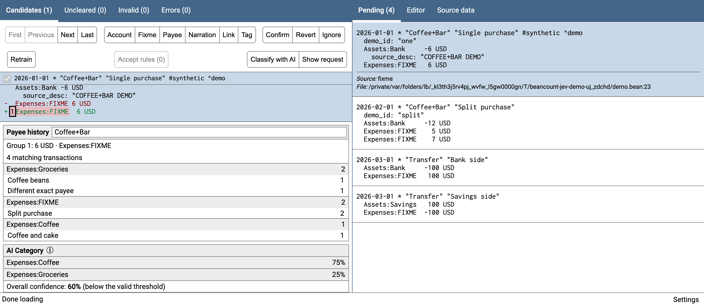
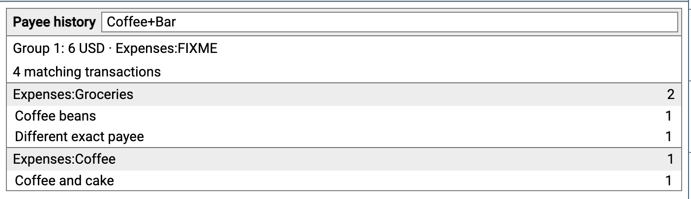
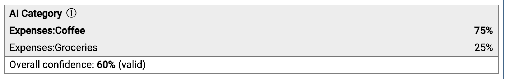
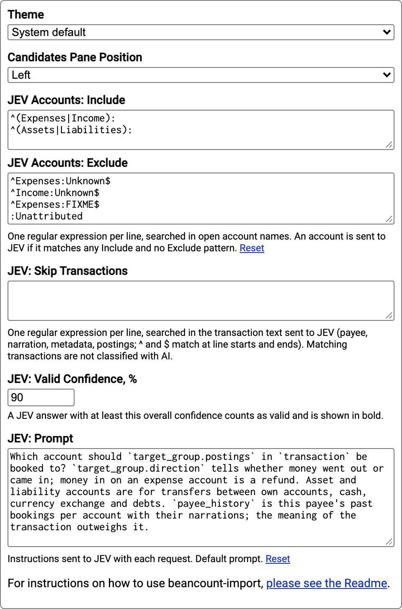

# beancount-import with category hints

This fork of [jbms/beancount-import](https://github.com/jbms/beancount-import)
helps choose the account for the unknown leg (`Expenses:FIXME`) of an imported
transaction. It adds two tools to the candidate review page:

- **Payee history.** Past bookings of the payee, grouped by account and listing
  their usual narrations. One click applies an account or a narration.
- **AI classification (optional).** An on-demand request to the
  [JEV](https://openrouter.ai/~typesafe/jev-latest) decision model on OpenRouter. The model suggests
  an account from your ledger together with a confidence score.

Everything else is upstream beancount-import: the data sources, the matching,
the built-in classifier and the Confirm workflow. The fork is a drop-in
replacement, so existing launchers keep working.

Full diff against upstream:
[compare](https://github.com/jbms/beancount-import/compare/master...viktor-235:beancount-import:category-hints).



## Features

### Payee history



- The panel appears under the candidates. It shows how often the selected payee
  was booked to each account, plus the most frequent narrations per account.
- Search starts with the payee. It matches substrings in payee, narration and
  metadata, ignoring case and punctuation. Clear the search box to search the
  whole ledger.
- Click an account to set it on the target posting group. Click a narration to
  copy it to the candidate. Accounts, payee, tags and links are preserved.
  Nothing is written until you press the usual **Confirm**.
- When a transaction has several unknown posting groups, pick the target group
  explicitly.
- History is built from the plugin-processed ledger and refreshes after every
  Confirm or reload.

### AI classification with JEV



- Press **Classify with AI** or the `c` key. Each press sends exactly one
  request. There are no automatic calls, retries, prefetching or caching.
- **Show request** previews the exact JSON locally. It never contacts
  OpenRouter.
- The request contains:
  - the candidate transaction;
  - the target posting group and its direction (money in or money out);
  - the allowed accounts with their `note` metadata;
  - per-account payee history (counts and up to 5 narrations).
- Only accounts that are open on the transaction date are offered.
- The answer shows the suggested account, its confidence and, when available,
  the probabilities of the other accounts. Answers at or above the valid
  confidence threshold are shown in bold. Click an account to apply it.
- An answer is discarded when the candidate changes, so a late reply never
  lands on the wrong transaction.

### Import rules

`--import_rules PATH` (or `import_rules=` in a launcher) applies rules from a
YAML file to every imported transaction, from any data source. A rule has a
[Fava filter](https://fava.pythonanywhere.com/example-beancount-file/help/filters)
and actions:

```yaml
x-auto-confirm: &auto-confirm
  addPostingMeta:
    categorizer: rules

rules:
  - <<: *auto-confirm
    filter: 'payee:"^Spotify AB$"'
    setAccount: Expenses:Entertainment:Other
    setNarration: Spotify Subscription
    addTags: "#recurring"
    addMeta: {subscriptionName: Spotify}
```

| Action | Effect |
|---|---|
| `setAccount` | Replaces every unknown account (`Expenses:FIXME` and `Expenses:FIXME:*`) |
| `addPostingMeta` | Metadata for that posting; needs `setAccount` |
| `setPayee`, `setNarration` | Replace the payee or narration |
| `addTags`, `addMeta` | Add tags (`"#a #b"`) or transaction metadata |

- Matching rules apply in order. Tags and metadata accumulate; for the other
  actions the first rule wins, and a different value from a later rule is
  reported as a warning.
- Fava filters ignore case. A quote inside a filter string needs the other
  quote style: `payee:'^IP "OSPANOVA"$'`.
- Top-level keys starting with `x-` only hold YAML anchors. `<<` replaces
  whole keys, so a rule with its own `addPostingMeta` drops the anchor's one.
- Rules run after the source has stored the original narration in
  `source_desc`, so `setNarration` does not create duplicates on re-import.
- Accounts are not checked: a typo in `setAccount` opens a new account on
  Confirm.
- The file is reloaded with the journal. On an error, all rules are disabled
  and the error is listed in the UI.
- Requires fava: `pip install "beancount-import[rules] @ git+https://github.com/viktor-235/beancount-import@category-hints"`.

### Accept rules

- **Accept rules (N)** in the candidate toolbar confirms every pending
  transaction that the importer fully categorized by its rules: no unknown
  account is left and some posting has `categorizer: "rules"` metadata.
  N is the number of transactions the button will confirm.
- A transaction that matches another one (a possible duplicate or a transfer
  leg) is left for manual review.
- The transactions are written exactly like a manual Confirm, without AI
  requests.

### Settings



The settings are stored per browser (`localStorage`) and sent with each request.

| Setting | Default | Purpose |
|---|---|---|
| JEV Accounts: Include / Exclude | include `^(Expenses\|Income):`, `^(Assets\|Liabilities):`; exclude `Expenses:Unknown`, `Income:Unknown`, `Expenses:FIXME`, `:Unattributed` | Regular expressions (one per line, Python `re.search`) selecting the accounts offered to JEV |
| JEV: Skip Transactions | empty | Regular expressions on the transaction text. On a match, AI is disabled for that transaction and the server rejects it too |
| JEV: Valid Confidence, % | 90 | Threshold for marking an answer as valid |
| JEV: Prompt | built-in | Instructions sent to the model. Clear the field to return to the default |

## Installation

Requires Python ≥ 3.10 (upstream: 3.9) and Node ≥ 18 to build the frontend.

```sh
pip install "git+https://github.com/viktor-235/beancount-import@category-hints"
```

Configure the data sources and launcher as described in the
[upstream README](README.md#usage). To enable AI classification, set these
environment variables before starting the server:

```sh
export OPENROUTER_API_KEY=sk-or-...
export JEV_MODEL=~typesafe/jev-latest   # optional, this is the default
```

Without a key, payee history and Show request still work. The AI button is
disabled.

## Privacy

Data leaves your machine **only** when you press Classify with AI. Each request
sends the transaction text and metadata, account names and notes, and payee
history (counts and narrations) to OpenRouter. The server does not log or store
requests or answers. Use Skip Transactions to keep particular accounts or
payees away from AI completely.

The OpenRouter decisions endpoint is in alpha and may change. Confidence is the
model's own estimate, not a guarantee.

## Demo

The demo runs on a synthetic ledger with mocked AI replies:

```sh
python examples/jev/run.py --mock-jev --port 8106
```

Then open http://127.0.0.1:8106/. See [examples/jev/README.md](examples/jev/README.md).

## Differences from upstream

| Area | Change |
|---|---|
| Backend | New `beancount_import/history_hints.py` (candidate snapshot, history search) and `beancount_import/jev.py` (request building, OpenRouter client) |
| Backend | `webserver.py`: `/hints/{history,request,classify}` endpoints, a stale-candidate guard on `change_candidate`, and JEV state in the initial state |
| Backend | `journal_editor.py`: keeps the plugin-processed entries for history |
| Backend | New `beancount_import/import_rules.py`; `reconcile.py` applies the rules to pending transactions and adds Accept rules; `webserver.py` adds `--import_rules`, the `/accept_rules` endpoint and the `rules_pending` count in the state |
| Frontend | New `history_hints.tsx` and `jev_settings.ts`. Changes to `candidates.tsx` (panel, `c` shortcut), `settings.tsx` (JEV settings) and `styles.css` |
| Tests | `jev_test.py`, `history_hints_test.py`, `accept_rules_test.py`, `import_rules_test.py` and `frontend/history_hints.test.cjs` (`npm test`) |
| Packaging | `python_requires >= 3.10`. Optional `rules` extra with fava. CI also runs `npm test`. PyPI publishing is removed (the fork is not published to PyPI) |

The source adapters, matching rules and the built-in classifier are unchanged.

## Development

```sh
pip install -e .
python -m pytest -q
npm --prefix frontend run tsc
npm --prefix frontend test
npm --prefix frontend run build
```

The tests use synthetic data and mock every external call.

### Syncing with upstream

```sh
git remote add upstream https://github.com/jbms/beancount-import.git
git fetch upstream
git checkout master && git merge --ff-only upstream/master
git checkout category-hints && git rebase master
```

## License

Like upstream, this fork is distributed under the
[GNU General Public License, version 2.0 only](LICENSE).
