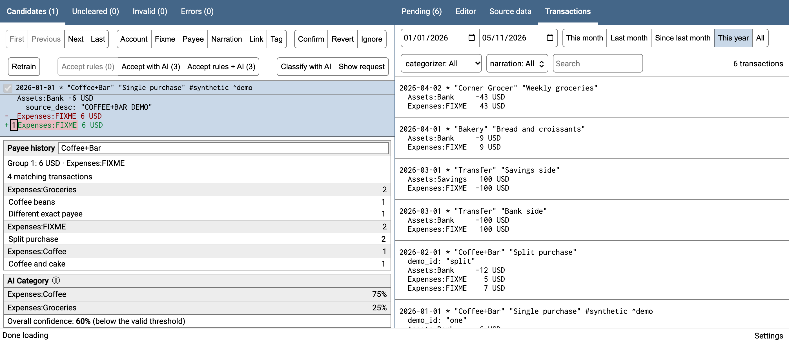
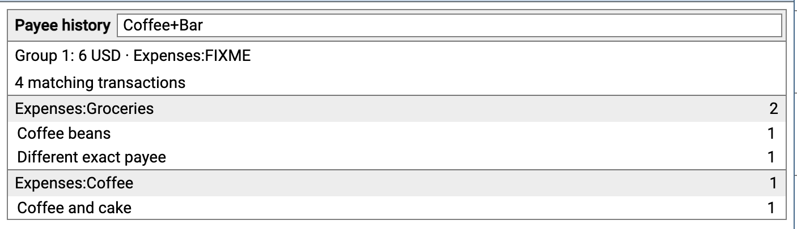
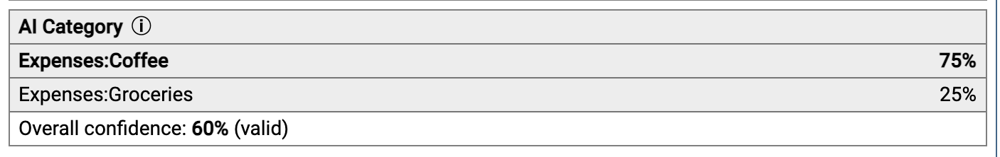
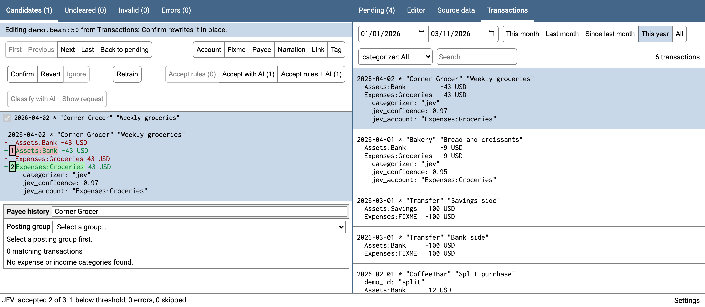

# beancount-import with category hints

This fork of [jbms/beancount-import](https://github.com/jbms/beancount-import)
helps choose the account for the unknown leg (`Expenses:FIXME`) of an imported
transaction. It adds two tools to the candidate review page:

- **Payee history.** Past bookings of the payee, grouped by account and listing
  their usual narrations. One click applies an account or a narration.
- **AI classification (optional).** An on-demand request to the
  [JEV](https://openrouter.ai/~typesafe/jev-latest) decision model on OpenRouter. The model suggests
  an account from your ledger together with a confidence score.
- **Import rules and batch accept.** Rules categorize imported transactions;
  Accept rules, Accept with AI and Accept rules + AI confirm many pending
  transactions at once.
- **Transactions tab.** Journal transactions filtered by date, categorizer and
  text, to review what rules, AI and manual work booked.

Everything else is upstream beancount-import: the data sources, the matching,
the built-in classifier and the Confirm workflow. The fork is a drop-in
replacement, so existing launchers keep working.

Full diff against upstream:
[compare](https://github.com/jbms/beancount-import/compare/master...viktor-235:beancount-import:category-hints).



## Features

### Payee history



- The panel appears under the candidates. It shows how often the selected payee
  was booked to each account, plus the most frequent narrations per account.
  Hover a narration to see its distinct amounts with counts, most frequent
  first, then largest; past 5, only the number of the rest.
- Search starts with the payee. It matches substrings in payee, narration and
  metadata, ignoring case and punctuation. Clear the search box to search the
  whole ledger.
- Click an account to set it on the target posting group. Click a narration to
  copy it to the candidate. Accounts, payee, tags and links are preserved.
  Nothing is written until you press the usual **Confirm**.
- When a transaction has several unknown posting groups, pick the target group
  explicitly.
- History is built from the plugin-processed ledger and refreshes after every
  Confirm or reload.

### AI classification with JEV



- Press **Classify with AI** or the `c` key. Each press sends exactly one
  request. There are no automatic calls, retries, prefetching or caching.
- **Show request** previews the exact JSON locally. It never contacts
  OpenRouter.
- The request contains:
  - the candidate transaction;
  - the target posting group and its direction (money in or money out);
  - the allowed accounts with their `note` metadata;
  - per-account payee history (counts and up to 5 narrations).
- Only accounts that are open on the transaction date are offered.
- The answer shows the suggested account, its confidence and, when available,
  the probabilities of the other accounts. Answers at or above the valid
  confidence threshold are shown in bold. Click an account to apply it.
- An answer is discarded when the candidate changes, so a late reply never
  lands on the wrong transaction.
- Classify with AI and Show request are disabled while the settings file is
  invalid. Classify with AI is also disabled for a transaction matched by
  `skip_transactions`.

### Import rules

`--import_rules PATH` (or `import_rules=` in a launcher) applies rules from a
YAML file to every imported transaction, from any data source. A rule has a
[Fava filter](https://fava.pythonanywhere.com/example-beancount-file/help/filters)
and actions:

```yaml
x-auto-confirm: &auto-confirm
  addPostingMeta:
    categorizer: rules

rules:
  - <<: *auto-confirm
    filter: 'payee:"^Spotify AB$"'
    setAccount: Expenses:Entertainment:Other
    setNarration: Spotify Subscription
    addTags: "#recurring"
    addMeta: {subscriptionName: Spotify}
```

| Action | Effect |
|---|---|
| `setAccount` | Replaces every unknown account (`Expenses:FIXME` and `Expenses:FIXME:*`) |
| `addPostingMeta` | Metadata for that posting; needs `setAccount` |
| `removePostingMeta` | Drops these keys from `addPostingMeta` of any rule: `[categorizer]` |
| `setPayee`, `setNarration` | Replace the payee or narration; `{key}` inserts transaction metadata |
| `addTags`, `addMeta` | Add tags (`"#a #b"`) or transaction metadata |

- Matching rules apply in order. Tags, metadata and `removePostingMeta`
  accumulate; for the other actions the first rule wins, and a different value
  from a later rule is reported as a warning.
- `{key}` takes the value from the transaction metadata (after `addMeta`);
  `{{` and `}}` are literal braces. A missing key leaves the field unchanged
  with a warning. To let a note from the bank override other rules and keep the
  transaction out of Accept rules, put such a rule first:

  ```yaml
  - filter: 'ing_tag:"."'
    setNarration: '{ing_tag}'
    removePostingMeta: [categorizer]
  ```
- Fava filters ignore case. A quote inside a filter string needs the other
  quote style: `payee:'^IP "OSPANOVA"$'`.
- Top-level keys starting with `x-` only hold YAML anchors. `<<` replaces
  whole keys, so a rule with its own `addPostingMeta` drops the anchor's one.
- Rules run after the source has stored the original narration in
  `source_desc`, so `setNarration` does not create duplicates on re-import.
- Accounts are not checked: a typo in `setAccount` opens a new account on
  Confirm.
- The file is reloaded with the journal. On an error, all rules are disabled
  and the error is listed in the UI.
- Requires fava: `pip install "beancount-import[rules] @ git+https://github.com/viktor-235/beancount-import@category-hints"`.

### Accept rules

- **Accept rules (N)** in the candidate toolbar confirms every pending
  transaction that the importer fully categorized by its rules: no unknown
  account is left and some posting has `categorizer: "rules"` metadata.
  N is the number of transactions the button will confirm.
- A transaction that matches another one (a possible duplicate or a transfer
  leg) is left for manual review.
- The transactions are written exactly like a manual Confirm, without AI
  requests.

### Accept with AI

- **Accept with AI (N)** classifies pending transactions with JEV and confirms
  every answer whose confidence is at least `valid_confidence`. A transaction
  qualifies if it has exactly one unknown posting group, matches no other
  transaction (as for Accept rules) and is not matched by `skip_transactions`.
  Journal transactions with `Expenses:FIXME` qualify too. N is the number of
  transactions that will be sent.
- **Accept rules + AI (N)** goes through the transactions in the order of the
  Pending list and confirms each one by rules if they fully categorize it,
  otherwise with AI, so `categorizer: "rules"` and `categorizer: "jev"`
  transactions are confirmed in that order. N is the sum of both; a transaction that
  rules changed but left with an unknown account goes to AI with the rules'
  changes.
- Before any request, a dialog states how many transactions go to OpenRouter;
  each is a separate paid request.
- Requests run one at a time on the server, and each confident answer is
  confirmed right away. The pressed button shows **Stop (i/N)**; stopping
  waits for the current request. Confirm, Skip, Classify and the other batch
  buttons are disabled meanwhile. Progress survives a page reload.
- Answers below the threshold leave the transaction pending and unchanged.
  Nothing is cached: pressing the button again sends them again.
- An invalid API key, missing credits or a rate limit stops the run. A timeout
  or an invalid answer skips the transaction; three such errors in a row stop
  the run. The status bar shows the result: accepted X of N (R of them by
  rules, for Accept rules + AI), Y below the threshold, Z errors, S skipped.
- A confirmed posting gets metadata, so AI bookings can be found and reviewed
  later. Clicking a suggestion of Classify with AI adds none.

  ```beancount
  Expenses:Groceries  9 USD
    categorizer: "jev"
    jev_confidence: 0.95
    jev_account: "Expenses:Groceries"
  ```

### Transactions tab



- The right panel has a **Transactions** tab after Source data. It lists the
  transactions of the journal files as written (not plugin-processed, the
  ignored journal excluded), newest first. The count of matching transactions
  is shown above the list.
- Filters:
  - **Dates**: from and to, inclusive, as the browser's native date fields
    (the display format follows the browser locale); an empty field is an
    open bound. Presets: This month, Last month, Since last month (the default), This year, All.
  - **Categorizer**: one select, `categorizer: All`, `categorizer: (none)`
    (no posting has `categorizer` metadata) or `categorizer: <value>` for a
    value found in the journal (`rules`, `jev`). A transaction matches when
    any posting has the value.
  - **Search**: like Payee history, a case- and punctuation-insensitive
    substring of payee, narration and metadata, plus account names.
- Click a transaction to edit it in the Candidates tab; its row is
  highlighted. Category postings (accounts not tied to a data source, such as
  expenses, income or cash) become editable account groups, pre-filled with
  their current accounts; data source postings stay fixed. Payee, narration,
  tags, links, Payee history and Classify with AI work as for a pending entry.
- **Confirm** rewrites the transaction in place, in its file; metadata, tags and
  links are kept. When only a posting's account changes, just the account name
  is replaced in its line: the amount (elided too), alignment, price and an
  inline comment stay; comment lines inside the transaction are kept. An
  edited header line keeps a `txn` flag and a trailing `; comment`. A
  transaction whose layout cannot be rewritten line by line (multi-line
  strings, tab-indented metadata) is refused with a message. A posting whose
  account changed loses its `categorizer`, `jev_confidence` and `jev_account`
  metadata. An unchanged Confirm does not
  write the file (CRLF line ends stay too). Ignore is not available.
- After Confirm the next row of the list opens; after the last row, Candidates
  returns to the pending entries. First, Previous, Next, Last (and `[`, `]`)
  move through the rows of the list; **Back to pending** returns without
  writing. Changes are discarded when you leave the transaction without
  Confirm, and a journal change (Confirm, batch accept, reload) ends editing.
  Use the used transaction above the candidate to open it in the Editor.
- The list refreshes after every Confirm, batch accept and journal reload. The
  server filters only while the tab is open; the filter is kept while the page
  is open and resets on reload.

### Settings file

`--settings PATH` (or `settings=` in a launcher) reads JEV settings from the
`jev:` key of a YAML file. Without it, the defaults below are used. The server
only reads the file; edit it by hand. Top-level keys starting with `x-` are
ignored, other keys are errors.

```yaml
jev:
  account_filters:
    include: ['^(Expenses|Income):', '^(Assets|Liabilities):']
    exclude: ['^Expenses:Unknown$', '^Income:Unknown$', '^Expenses:FIXME$', ':Unattributed']
  skip_transactions: []
  valid_confidence: 90
  prompt: null
```

| Key | Default | Purpose |
|---|---|---|
| `account_filters` | as above | Regular expressions (Python `re.search`) selecting the accounts offered to JEV: an account matching any `include` and no `exclude` pattern. A missing list keeps its default |
| `skip_transactions` | empty | Regular expressions searched in the transaction text sent to JEV (`^` and `$` match at line boundaries). Matching transactions are never sent |
| `valid_confidence` | 90 | Percent. Answers at or above it are shown in bold and confirmed by Accept with AI |
| `prompt` | `null` (built-in) | Instructions sent to the model |

- The file is reloaded with the journal, like the import rules.
- On an error, all AI features are disabled and the error is listed in the UI.
  Accept rules keeps working.

## Installation

Requires Python ≥ 3.10 (upstream: 3.9) and Node ≥ 18 to build the frontend.

```sh
pip install "git+https://github.com/viktor-235/beancount-import@category-hints"
```

Configure the data sources and launcher as described in the
[upstream README](README.md#usage). To enable AI classification, set these
environment variables before starting the server:

```sh
export OPENROUTER_API_KEY=sk-or-...
export JEV_MODEL=~typesafe/jev-latest   # optional, this is the default
```

Without a key, payee history and Show request still work. The AI buttons are
disabled.

## Privacy

Data leaves your machine **only** when you press Classify with AI or confirm
the dialog of Accept with AI or Accept rules + AI. A batch sends one request
per transaction, N in total. Each request sends the transaction text and
metadata, account names and notes, and payee history (counts and narrations)
to OpenRouter. The server does not log or store requests or answers; only the
confirmed account and confidence are written to the journal as metadata. Use
`skip_transactions` to keep particular accounts or payees away from AI
completely.

The OpenRouter decisions endpoint is in alpha and may change. Confidence is the
model's own estimate, not a guarantee.

## Demo

The demo runs on a synthetic ledger with mocked AI replies:

```sh
python examples/jev/run.py --mock-jev --port 8106
```

Then open http://127.0.0.1:8106/. See [examples/jev/README.md](examples/jev/README.md).

## Differences from upstream

| Area | Change |
|---|---|
| Backend | New `beancount_import/history_hints.py` (candidate snapshot, history search) and `beancount_import/jev.py` (request building, OpenRouter client) |
| Backend | `webserver.py`: `/hints/{history,request,classify}` endpoints, a stale-candidate guard on `change_candidate`, and JEV state in the initial state |
| Backend | JEV settings file (`--settings`, `jev.load_settings`); Accept with AI: `reconcile.py` selects and accepts transactions, `webserver.py` adds `/jev_batch`, `/jev_batch_stop`, the background run and the `ai_pending`/`jev_run` state |
| Backend | `journal_editor.py`: keeps the plugin-processed entries for history; an in-place rewrite keeps comment lines, a header's `txn` flag and trailing comment and, when only the account changes, the original posting line text; a file without changes is not written |
| Backend | New `beancount_import/import_rules.py`; `reconcile.py` applies the rules to pending transactions and adds Accept rules; `webserver.py` adds `--import_rules`, the `/accept_rules` endpoint and the `rules_pending` count in the state |
| Backend | New `beancount_import/transactions.py` (Transactions tab filtering); `webserver.py` adds the `/transactions` endpoint and `journal_generation` in the state |
| Backend | Editing journal transactions: `reconcile.py` `make_review_candidates` (category postings as editable groups, rewritten in place); `webserver.py` adds `/review/(open\|close)`, the `review` state and the next row after Confirm |
| Frontend | New `transactions.tsx` and `transactions_filter.ts` (Transactions tab, editing in Candidates); `ServerListCache` takes a fetch function |
| Frontend | New `history_hints.tsx` and `jev_batch.ts`. Changes to `candidates.tsx` (panel, `c` shortcut, batch buttons, editing journal transactions) and `styles.css` |
| Tests | `jev_test.py`, `jev_batch_test.py`, `history_hints_test.py`, `accept_rules_test.py`, `import_rules_test.py`, `transactions_test.py`, `review_test.py`, `frontend/history_hints.test.cjs`, `frontend/jev_batch.test.cjs` and `frontend/transactions_filter.test.cjs` (`npm test`) |
| Packaging | `python_requires >= 3.10`. Requires PyYAML. Optional `rules` extra with fava. CI also runs `npm test`. PyPI publishing is removed (the fork is not published to PyPI) |

The source adapters, matching rules and the built-in classifier are unchanged.

## Development

```sh
pip install -e .
python -m pytest -q
npm --prefix frontend run tsc
npm --prefix frontend test
npm --prefix frontend run build
```

The tests use synthetic data and mock every external call.

### Syncing with upstream

```sh
git remote add upstream https://github.com/jbms/beancount-import.git
git fetch upstream
git checkout master && git merge --ff-only upstream/master
git checkout category-hints && git rebase master
```

## License

Like upstream, this fork is distributed under the
[GNU General Public License, version 2.0 only](LICENSE).
